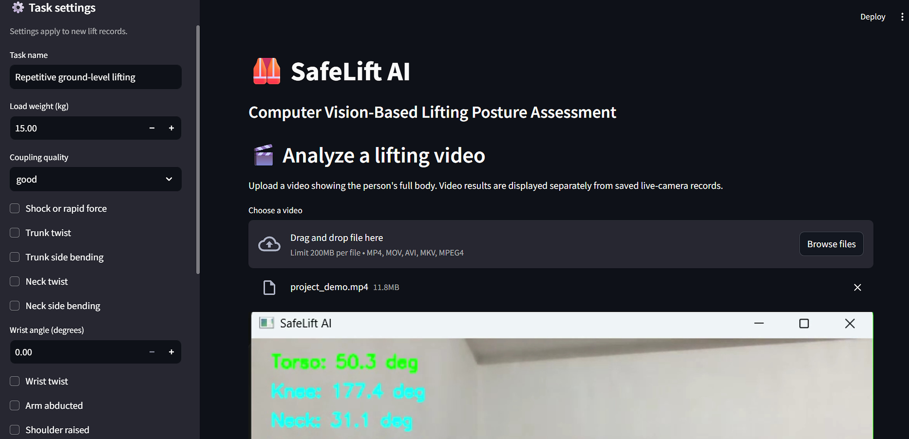
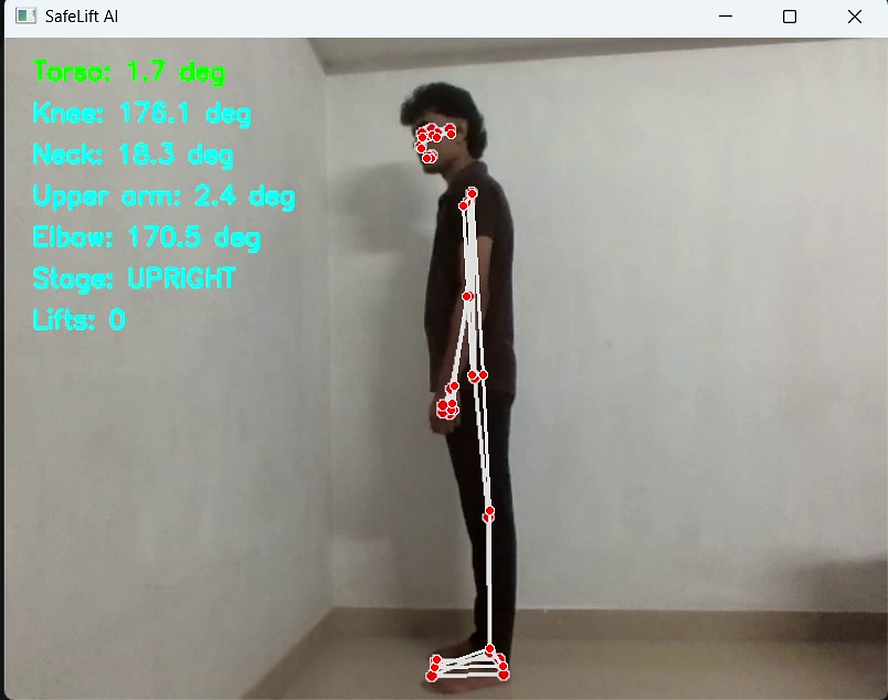
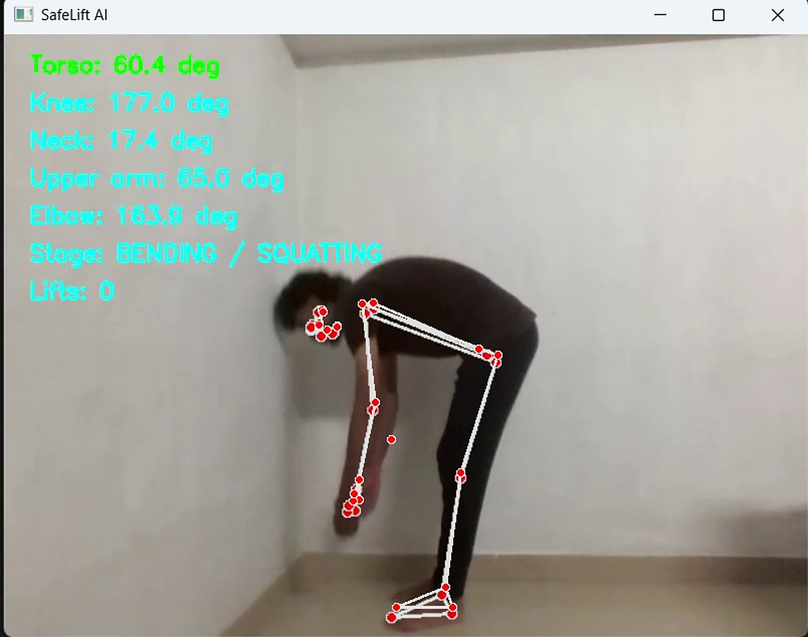
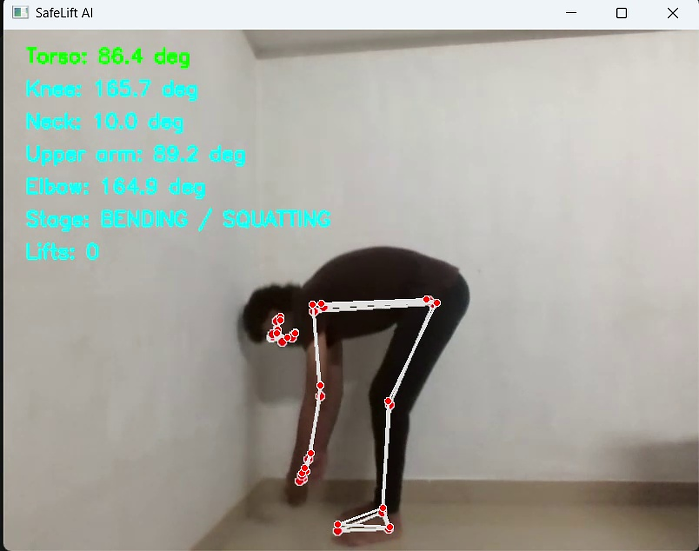
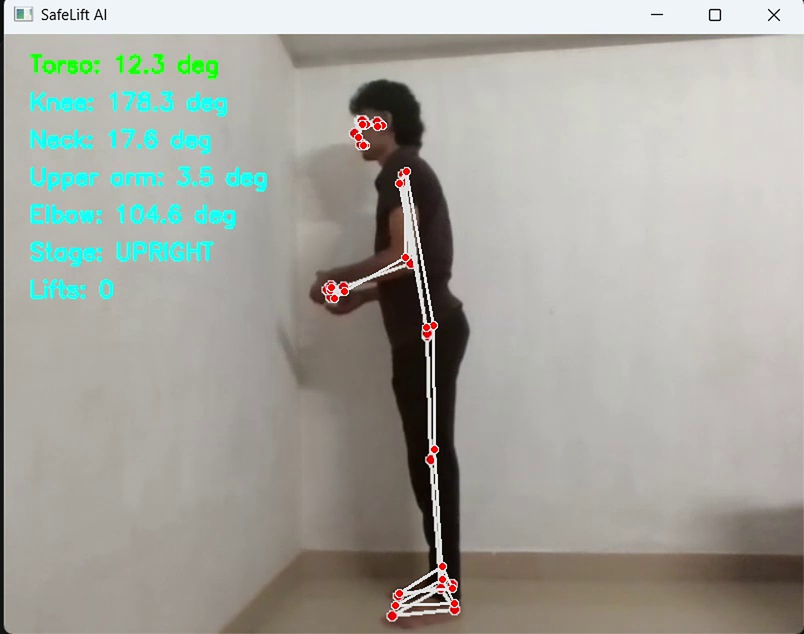
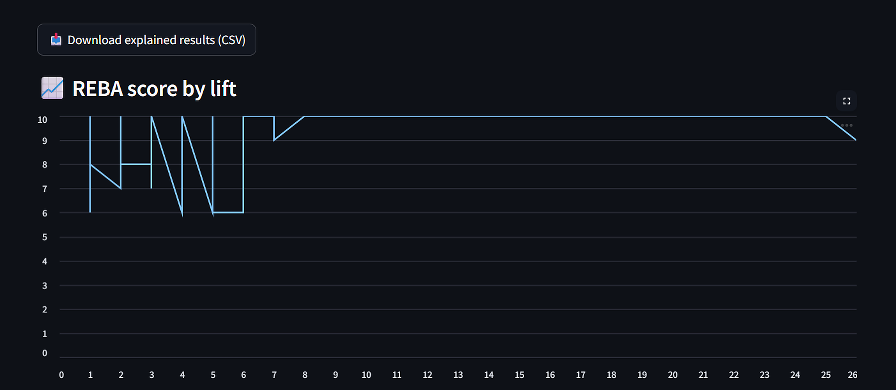
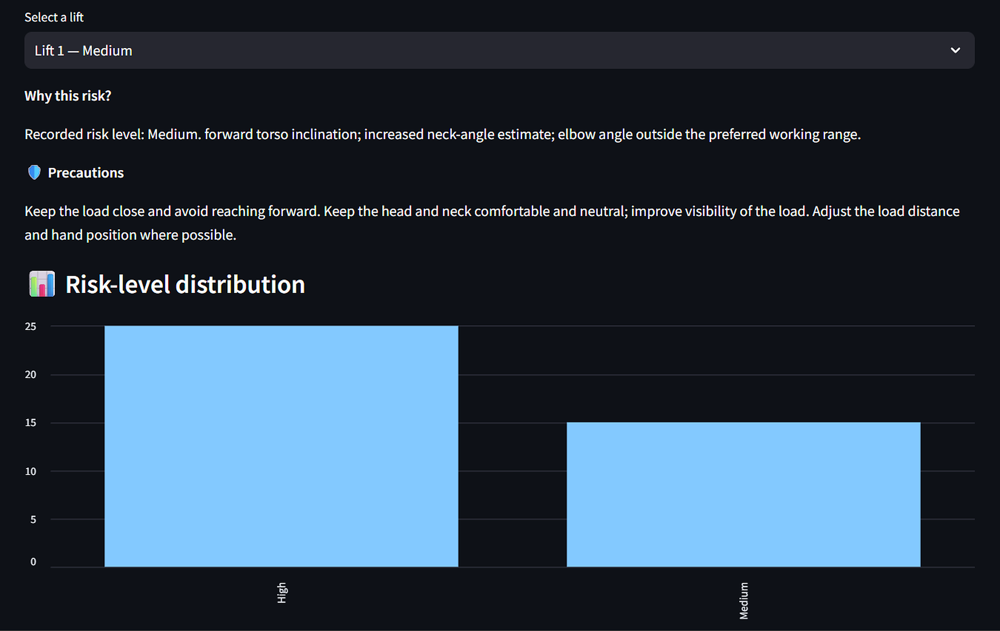

<div align="center">

# 🏋️ SafeLift AI

### Real-Time Lifting Posture Analysis & Ergonomic Risk Assessment

*An AI-powered computer vision system that detects unsafe manual-lifting posture and scores ergonomic risk using the REBA method, using nothing more than a camera.*

<br>


<br>

### 🚀 [**Launch the Live Application**](https://safelift-hz2rsd8dvcvcpezzvhlf4m.streamlit.app/)

<br>



</div>

---

## 📑 Table of Contents

1. [Overview](#-overview)
2. [Problem Statement](#-problem-statement)
3. [Key Features](#-key-features)
4. [Live Demo](#-live-demo)
5. [System Workflow](#-system-workflow)
6. [Measured Joint Angles](#-measured-joint-angles)
7. [Lift Stage Detection](#-lift-stage-detection)
8. [REBA Risk Assessment](#-reba-risk-assessment)
9. [Results & Visualisations](#-results--visualisations)
10. [Technology Stack](#-technology-stack)
11. [Project Structure](#-project-structure)
12. [Installation](#-installation)
13. [Usage](#-usage)
14. [Deployment](#-deployment)
15. [Limitations](#-limitations)
16. [Future Improvements](#-future-improvements)
17. [References](#-references)
18. [Author](#-author)

---

## 📖 Overview

**SafeLift AI** analyses a person's lifting technique from video or a live webcam feed. It uses pose estimation to track body landmarks, calculates key joint angles frame by frame, identifies the current stage of the lift, counts completed lifts, and converts the measured posture into an ergonomic risk score based on the **Rapid Entire Body Assessment (REBA)** method.

The result is instant, objective, sensor-free feedback on whether a lift is performed safely, supporting workplace safety, ergonomics training, and injury prevention.

---

## ⚠️ Problem Statement

Manual material handling is a leading cause of work-related musculoskeletal disorders, particularly lower-back injuries. Common risk factors include:

- Excessive forward bending of the torso
- Lifting with straight legs instead of bending the knees
- Neck flexion while handling loads
- Poor arm positioning during the lift

Traditional ergonomic assessments are **manual, subjective, and time-consuming**, usually requiring a trained observer with checklists or specialised wearable sensors. SafeLift AI automates this process with a camera-based approach that is accessible, repeatable, and fast.

---

## ✨ Key Features

| Feature | Description |
|---|---|
| 🎥 **Real-time pose tracking** | Detects body landmarks from webcam or recorded video |
| 📐 **Joint angle measurement** | Live torso, knee, neck, upper arm, and elbow angles |
| 🔄 **Lift stage detection** | Classifies each frame as upright or bending / squatting |
| 🔢 **Lift counter** | Automatically counts completed lift cycles |
| 📊 **REBA risk scoring** | Converts posture into a standardised ergonomic risk level |
| 📈 **Analysis charts** | Lift analysis, REBA chart, and risk analysis visualisations |
| 🌐 **Web application** | Interactive Streamlit interface, accessible from any browser |

---

## 🌐 Live Demo

The application is deployed on Streamlit Community Cloud and runs directly in the browser with no installation required.

👉 **[Open SafeLift AI](https://safelift-hz2rsd8dvcvcpezzvhlf4m.streamlit.app/)**

> **Note:** Free-tier Streamlit apps go to sleep after a period of inactivity. If you see a *"Yes, get this app back up"* button, click it and wait a few seconds for the app to restart.

---

## 🔄 System Workflow

```
        🎥  Video / Webcam Input
                  │
                  ▼
        🦴  Pose Landmark Detection
                  │
                  ▼
        📐  Joint Angle Calculation
   (torso · knee · neck · upper arm · elbow)
                  │
                  ▼
        🔄  Lift Stage Detection
        & Lift Counting
                  │
                  ▼
        📊  REBA Risk Scoring
                  │
                  ▼
        📈  Charts & Risk Report
```

**Pipeline description**

1. **Input:** frames are read from an uploaded video or a live camera.
2. **Pose detection:** body landmarks are extracted from every frame.
3. **Angle computation:** joint angles are calculated from landmark coordinates using vector geometry.
4. **Stage detection:** the torso angle drives a state machine that tracks the lift phase and increments the lift counter on each completed cycle.
5. **Risk scoring:** measured angles are mapped to REBA body-segment scores.
6. **Reporting:** results are displayed on screen and summarised in charts.

---

## 📐 Measured Joint Angles

The system overlays the skeleton and live angle readings on every frame.

| Angle | Description | Ergonomic relevance |
|---|---|---|
| **Torso** | Trunk inclination relative to vertical | Primary indicator of lower-back loading |
| **Knee** | Flexion at the knee joint | Shows whether the legs are used to lift |
| **Neck** | Neck flexion relative to the trunk | Indicates head and neck strain |
| **Upper arm** | Shoulder elevation / arm position | Reflects shoulder loading and reach |
| **Elbow** | Flexion at the elbow joint | Indicates how the load is being held |

---

## 🔄 Lift Stage Detection

A complete lift is tracked across several stages. The frames below are taken directly from the application output and show the live angle readings at each stage.

<div align="center">

| 1. Upright | 2. Start Bend | 3. Middle Bend | 4. Lowest | 5. Return |
|:---:|:---:|:---:|:---:|:---:|
|  |  |  |  |  |

</div>

| Stage | Torso angle (example) | Detected state |
|---|---|---|
| Upright | ≈ 2° – 12° | `UPRIGHT` |
| Start / middle bend | ≈ 60° | `BENDING / SQUATTING` |
| Lowest point | ≈ 86° | `BENDING / SQUATTING` |
| Return | ≈ 12° | `UPRIGHT` → lift counted |

---

## 📊 REBA Risk Assessment

**REBA (Rapid Entire Body Assessment)** is a widely used ergonomic method for evaluating whole-body postural risk. Individual body-segment scores are combined into a final score that maps to an action level:

| REBA score | Risk level | Action |
|:---:|---|---|
| 1 | Negligible | No action necessary |
| 2 – 3 | Low | Change may be needed |
| 4 – 7 | Medium | Further investigation, change soon |
| 8 – 10 | High | Investigate and implement change |
| 11 – 15 | Very high | Implement change immediately |

---

## 📉 Results & Visualisations

### 1. Lift Analysis

<div align="center">
  
</div>

### 2. REBA Chart

<div align="center">
  
</div>

### 3. Risk Analysis

<div align="center">
  
</div>

---

## 🛠️ Technology Stack

| Category | Technology | Purpose |
|---|---|---|
| Language | Python | Core development |
| Computer vision | OpenCV | Video capture, frame processing, overlays |
| Pose estimation | MediaPipe | Body landmark detection |
| Numerical computing | NumPy | Vector maths and angle calculation |
| Data handling | Pandas | Storing and summarising frame data |
| Visualisation | Matplotlib | Analysis and risk charts |
| Web framework | Streamlit | Interactive application |
| Experimentation | Jupyter Notebook | Development and analysis |
| Deployment | Streamlit Community Cloud | Hosting |
| Version control | Git and GitHub | Source code management |

---

## 📁 Project Structure

```
SAFELIFT/
│
├── README.md                  # Project documentation
├── app.py                     # Streamlit application
├── project.ipynb              # Development and analysis notebook
├── requirements.txt           # Python dependencies
├── packages.txt               # System-level packages for deployment
│
└── images/
    ├── main_app.png               # Application screenshot
    ├── lift analysis results.png  # Lift analysis output
    ├── reba_chart.png             # REBA chart
    ├── risk_analysis.png          # Risk analysis output
    │
    └── lift_examples/             # Lift-stage example frames
        ├── upright_img.png
        ├── start_bend_img.png
        ├── middle_bend_img.png
        ├── lower_img.png
        └── return_img.png
```

---

## ⚙️ Installation

### Prerequisites

- Python 3.9 or higher
- `pip`
- Git
- A webcam (optional, for live analysis)

### Steps

**1. Clone the repository**

```bash
git clone https://github.com/akhilm0001/SAFELIFT.git
cd SAFELIFT
```

**2. Create a virtual environment**

<details>
<summary><b>Windows</b></summary>

```bash
python -m venv venv
venv\Scripts\activate
```
</details>

<details>
<summary><b>macOS / Linux</b></summary>

```bash
python3 -m venv venv
source venv/bin/activate
```
</details>

**3. Install dependencies**

```bash
pip install -r requirements.txt
```

---

## ▶️ Usage

### Run the web application

```bash
streamlit run app.py
```

Then open the local URL shown in the terminal (usually `http://localhost:8501`).

### Using the app

1. Open the application (live link or local).
2. Provide a **side-view** video, or enable the webcam.
3. Watch the skeleton overlay, live joint angles, lift stage, and lift count.
4. Review the lift analysis, REBA chart, and risk analysis results.

### Run the analysis notebook

```bash
jupyter notebook project.ipynb
```

### Recommended recording setup

For the most accurate results:

- Film from the **side** so the torso, hips, and knees are clearly visible.
- Keep the **full body** in frame, from head to feet.
- Use **good, even lighting** with a plain background.
- Keep the camera **stationary** at roughly hip height.

---

## ☁️ Deployment

The application is deployed on **Streamlit Community Cloud**:

1. Push the repository to GitHub (with `app.py`, `requirements.txt`, and `packages.txt`).
2. Sign in to [Streamlit Community Cloud](https://streamlit.io/cloud) with GitHub.
3. Select the repository, branch `main`, and main file `app.py`.
4. Click **Deploy**.

`packages.txt` lists the system-level packages required by OpenCV in the cloud environment.

---

## ⚠️ Limitations

- Accuracy depends on camera angle, lighting, and how clearly the full body is visible.
- Analysis uses a **single 2D camera view**, so rotation and depth cannot be measured precisely.
- Pose estimation can be affected by loose clothing, occlusion, or cluttered backgrounds.
- The tool is intended for **screening and education**; it does not replace a professional ergonomic assessment.
- Load weight is not currently measured, which is also a factor in full REBA scoring.

---

## 🔮 Future Improvements

- 🔔 Real-time audio and visual alerts for unsafe posture
- ⚖️ Load estimation and integration of the NIOSH lifting equation
- 📄 Downloadable PDF risk reports
- 👥 Multi-person tracking
- 🎥 Multi-camera / 3D pose analysis
- 📱 Mobile and edge-device deployment
- 🗂️ Session history and progress tracking over time

---

## 📚 References

1. Hignett, S., & McAtamney, L. (2000). *Rapid Entire Body Assessment (REBA).* Applied Ergonomics, 31(2), 201–205.
2. Lugaresi, C. et al. (2019). *MediaPipe: A Framework for Building Perception Pipelines.* Google Research.
3. [MediaPipe Pose Documentation](https://developers.google.com/mediapipe)
4. [OpenCV Documentation](https://docs.opencv.org/)
5. [Streamlit Documentation](https://docs.streamlit.io/)

---

## 👨‍💻 Author

**Akhil M**

Computer Vision | Deep Learning | MediaPipe | Ergonomic Risk Assessment

[](https://github.com/akhilm0001)
[](https://safelift-hz2rsd8dvcvcpezzvhlf4m.streamlit.app/)
[](https://github.com/akhilm0001/SAFELIFT)

---

<div align="center">

⭐ **If you find this project useful, please consider giving the repository a star!** ⭐

</div>
